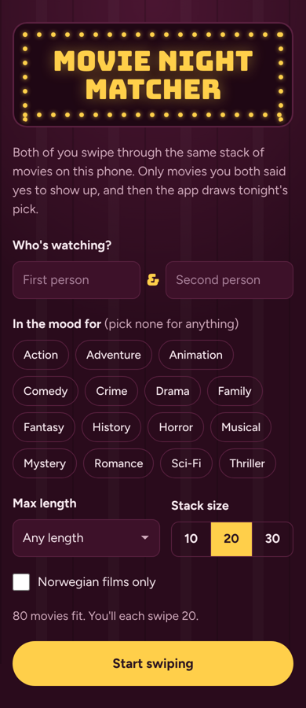
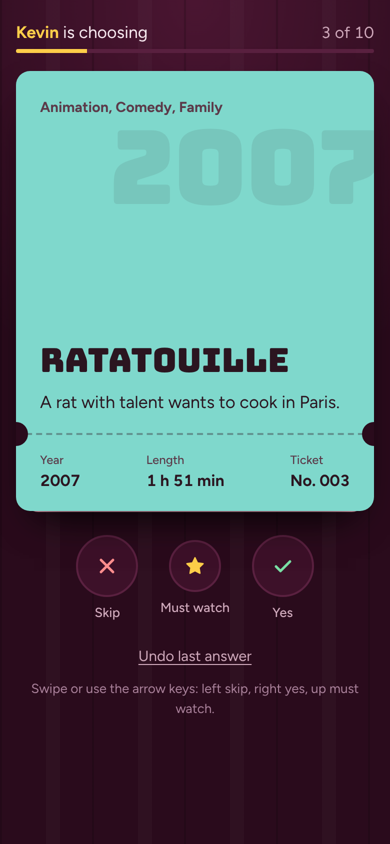
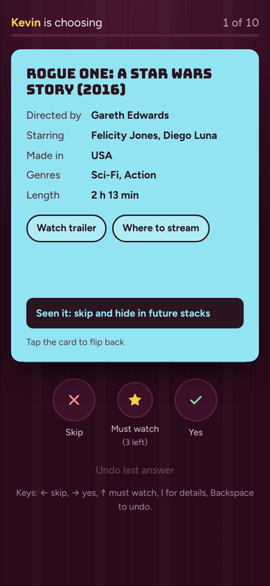
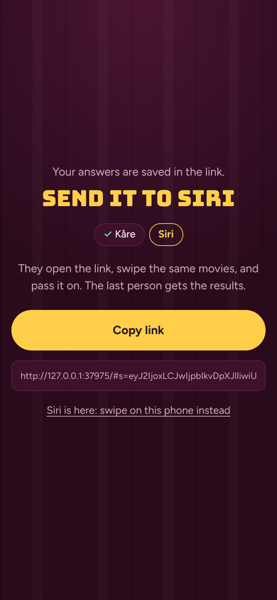
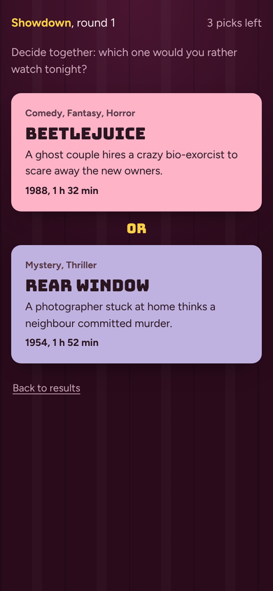
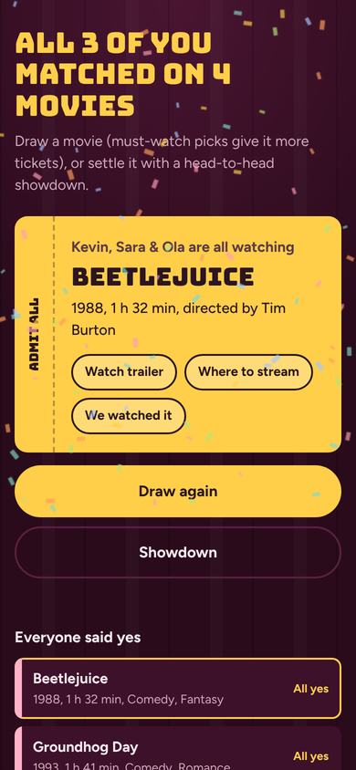

# Movie Night Matcher

**Stop scrolling, start watching.** 2 to 6 people swipe through the same stack of movies, on one phone or each on their own. Only the movies *everyone* said yes to make it through, and then the app draws tonight's pick or settles it with a head-to-head showdown.

**Live app:** https://kegun8344.github.io/IntroTilKI/

Made for *Mandatory Assignment 3: Vibe Coding* in DAVE3625, approach **C: recreate or improve an existing app**. It takes the swipe-to-match idea from dating apps and uses it on a problem every streaming service leaves you with: agreeing on what to watch.

| Setup | Swiping | Ticket details |
|---|---|---|
|  |  |  |
| **Own phones** | **Showdown** | **Results** |
|  |  |  |

## Short description (for Canvas)

Movie Night Matcher is a web app for groups who can't agree on a movie. Add 2–6 people, pick a vibe (feel-good, scary, date night and more) and optional filters, and everyone swipes the same stack from a catalogue of 570 movies: right for yes, left to skip, up for "must watch" (max 3 each). Tap a ticket to flip it for the director, cast, a trailer and where to stream it. Play by passing one phone, or each on your own phone: the game is stored in a link you send to the next person, and when everyone is done the results show up live on every phone, with no account or download. The results show what everyone said yes to and what almost made it, plus fun facts about the group. A weighted draw picks tonight's movie, or a head-to-head showdown decides it. The app can be installed on a phone and works offline. I built it with AI (Claude) through vibe coding. It is tested with 25 unit tests and a 92-check browser test, and the movie facts are checked automatically against two open datasets.

## Features

**Core**
1. **Swipe to vote.** Drag the ticket (touch or mouse), use the buttons or the arrow keys, and undo your last answer. "Must watch" is limited to 3 per person, so it means something.
2. **Match, draw or showdown.** Matches need a yes from everyone, and "almost" shows what all but one person liked. The draw is weighted (must-watch picks get extra tickets), and the showdown is a knockout bracket of your top 8.
3. **Two ways to play.** Pass one phone with a "no peeking" hand-off screen, or each person uses their own phone and passes on a link that holds the game. When the last person is done, the results and the drawn movie show up live on every phone that has the game open. If live updates can't connect, the last person sends the results back with a link instead, so it always works.

**Extras**
- 570 hand-picked movies from 27 countries, including 20 Norwegian films.
- Filters: vibe, genres, made in (Norway, Nordic, Asia and more), from/to decade, max length, and hiding movies you have seen.
- Flip a ticket to see the director, cast, a trailer search and where to stream (JustWatch Norway), and mark it "Seen it".
- Fun facts: the pickiest person, the easiest to please, and who is most in sync.
- History of past movie nights, "We watched it", and sharing or copying results.
- Installable as an app (PWA), works offline, optional sound and vibration, confetti for the winner.
- Accessible: keyboard controls, screen-reader labels, visible focus, and "reduce motion" respected.
- An [About page](about.html) explaining how the app was made.

## How to run it

It is a static site: no build step, no server code, no API keys. Live updates in "own phones" mode go through [ntfy.sh](https://ntfy.sh), a free, open-source message relay that needs no account or key.

- **Online:** open the live link above.
- **Locally:** run `python -m http.server 8000` in the folder and open http://localhost:8000. You can also double-click `index.html`, but offline mode only works over http.

### Publish on GitHub Pages
On GitHub go to **Settings → Pages → Deploy from a branch**, choose `main` and `/ (root)`, and click **Save**. The site updates about a minute after each push.

## Tests and checks

| What | Command | What it checks |
|---|---|---|
| Unit tests | `npm test` | 25 tests: catalogue validity, every vibe and region has movies, shuffling, all filters, must-watch limit, results for 2 and 4 players, weighted draw, fun facts, showdown brackets of every size, share links (incl. æøå and broken links), live messages (rejecting ones that don't fit the game), and the data build tool |
| Browser test | `npm install`, `npx playwright install chromium`, `npm run test:e2e` | 92 checks in a phone-sized Chromium: filters, 3 people on one phone (flip, undo, must-watch limit, seen it), results compared with expected answers, draw, showdown, saved settings, 2 phones via a share link (incl. results and the same winner on both phones, and a reload keeping the results), live updates between 2 phones through a local test relay (results and the draw appear by themselves, reload while waiting, link still works with no relay), broken link, offline reload, About page, leaving during a draw, no horizontal scrollbar, no JavaScript errors |
| Data build | `npm run build:movies` | Every line of `data/movies.txt`: fields, year, runtime, genres, country, pitch length and duplicates. It then regenerates `js/movies.js` |
| Fact check | `npm run check:facts` | Cross-checks year, cast, runtime and director against Wikipedia movie data and vega-datasets. Flags are reviewed by a person (`data/reviewed-flags.txt`) |

See [PROCESS.md](PROCESS.md) for how AI was used and which bugs were found.

## How it's built

| File | Job |
|---|---|
| `index.html` | The screens: setup, invite, swipe, hand-off, send link, results, showdown |
| `styles.css` | Cinema look: velvet curtain, marquee sign, movies as raffle tickets coloured by genre |
| `js/logic.js` | Pure game rules (filters, scoring, draw, showdown, share links, live messages). No DOM, so it can be unit tested |
| `js/app.js` | UI: rendering, swipe gestures, card flip, screen flow, storage, sharing, sound and confetti |
| `data/movies.txt` → `js/movies.js` | The catalogue: one movie per line, built and checked by `tools/build-movies.mjs` |
| `sw.js`, `manifest.webmanifest`, `icons/` | Offline support and "Add to home screen" |
| `about.html` | About page |
| `fonts/` | Bungee and Figtree (SIL Open Font License), bundled so the app works offline |

Plain HTML, CSS and JavaScript with no framework.

## Notes

- No posters or images from movies are used. Titles, years, runtimes, directors and cast are public facts, and the one-line pitches are written for this app. Runtimes are approximate.
- Not affiliated with any streaming service or app. Trailer and streaming buttons only open a YouTube or JustWatch search.
- Privacy: no accounts and no tracking. Names, settings, history and the seen list stay in your browser. A share link contains the names and answers of that game, so only send it to the people playing. In "own phones" mode the same names and answers also pass through ntfy.sh, in a channel with a random 22-character name that is only in your links, and ntfy deletes them after about 12 hours.
