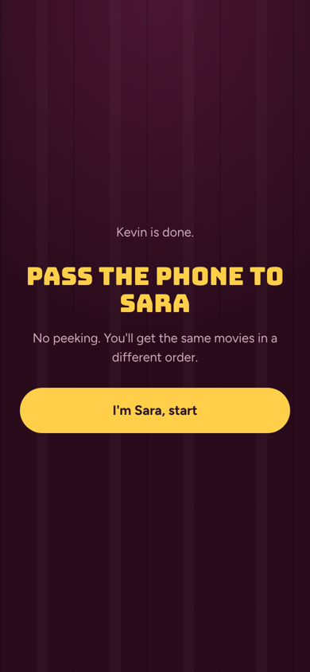
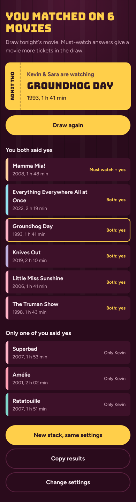

# Movie Night Matcher

**Stop scrolling, start watching.** Two people swipe through the same stack of movies on one phone. The app only shows the movies you *both* said yes to, and then draws tonight's pick.

**Live app:** https://YOUR-GITHUB-USERNAME.github.io/IntroTilKI/  <!-- replace after enabling GitHub Pages -->

Made for *Mandatory Assignment 3: Vibe Coding* in DAVE3625, approach **C: recreate or improve an existing app**. It borrows the swipe-to-match idea from dating apps and uses it on the classic "what should we watch tonight?" problem that every streaming service leaves you with.

| Setup | Swiping | Hand-off | Results |
|---|---|---|---|
|  |  |  |  |

## Short description (for Canvas)

Movie Night Matcher is a small web app for two people who can't agree on a movie. You enter both names, choose genres, maximum length and how many movies to swipe. Each person then swipes the same stack of movies on the same phone (in a different order, with a "pass the phone, no peeking" screen in between). Swipe right for yes, left to skip, or up for "must watch". The results screen lists the movies you both said yes to, plus the ones only one of you liked, and a weighted draw picks tonight's movie (a "must watch" gives a movie extra tickets in the draw). Past movie nights are saved in the browser. I built it with AI (Claude) through vibe coding: describing what I wanted, letting the AI write the code, and testing and improving it with automated tests.

## Features

1. **Swipe to vote.** Drag the ticket card (touch or mouse), use the buttons, or use the arrow keys. Undo your last answer.
2. **Match and draw.** Both players vote on the same movies. Matches are ranked (must watch + must watch on top), and "Draw tonight's movie" does a weighted random draw with a short spin animation.
3. **Filters and history.** Filter by genre, max length and Norwegian films only. The app warns you if no movies fit. Names, settings and the last 10 movie nights are remembered in the browser.

Extras: copy results to the clipboard (to send in a chat), works offline, keyboard accessible, and respects "reduce motion".

## How to run it

It is a static site with no build step and no server code.

- **Online:** open the GitHub Pages link above.
- **Locally:** double-click `index.html`, or run a tiny server in the folder: `python -m http.server 8000` and open http://localhost:8000.

### Publish on GitHub Pages
1. Commit and push the repo with GitHub Desktop.
2. On GitHub: **Settings → Pages → Build and deployment → Source: Deploy from a branch**, Branch: `main`, folder `/ (root)`, then **Save**.
3. After about a minute the link appears at the top of the Pages settings. Paste it into the "Live app" line above.

## Tests

| What | Command | Checks |
|---|---|---|
| Unit tests (game logic) | `node --test tests/logic.test.js` | 11 tests: movie data is valid, shuffling, filters, match scoring, weighted draw, text export |
| End-to-end (real browser, phone size) | `npm install`, `npx playwright install chromium`, `npm run test:e2e` | 19 checks: plays a full movie night with drag, buttons and keyboard, tests undo, checks that no horizontal scrollbar appears while swiping, checks that matches on screen equal the expected matches, the winner, history, settings after reload, and that there are no JavaScript errors |

See [PROCESS.md](PROCESS.md) for how AI was used and which bugs the tests found.

## How it's built

| File | Job |
|---|---|
| `index.html` | The four screens: setup, swipe, hand-off, results |
| `styles.css` | Cinema look: velvet background, marquee sign, movies as coloured raffle tickets (colour = genre) |
| `js/movies.js` | 80 hand-picked movies (incl. 6 Norwegian) with year, length, genres and a one-line pitch |
| `js/logic.js` | Pure game rules (filter, shuffle, scoring, weighted draw). No DOM, so it can be unit tested in Node |
| `js/app.js` | UI: rendering, swipe gestures, screen flow, localStorage |
| `fonts/` | Bungee and Figtree (SIL Open Font License), bundled so the app works offline |

Plain HTML, CSS and JavaScript with no framework, so it runs anywhere.

## Notes

- No posters or images from movies are used. Titles, years, lengths and genres are public facts, and the one-line pitches are written for this app. Runtimes are approximate.
- Not affiliated with any streaming service or dating app.
- No accounts, no API keys, no tracking. Everything you enter stays in your own browser (localStorage).
